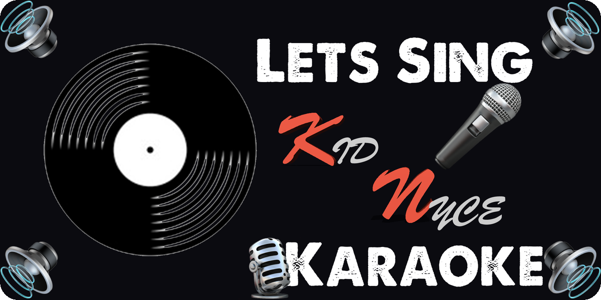

# Kid Nyce Karaoke



Karaoke for Kid Nyce's gigs. A fork of [PiKaraoke](https://github.com/vicwomg/pikaraoke)
built for a Raspberry Pi with one or two TVs, served over HTTPS at
`karaoke.djkidnyce.com`. Guests scan a QR code, type nothing, and queue songs from their
phones.

## What this fork adds

| Feature | What it does |
| --- | --- |
| One screen or two | Two TVs: lyrics for the singer on one, QR code, join code, singing order and sing along lyrics for the room on the other. One TV: everything on it. Auto detects the board and the TVs plugged in. |
| Join code per night | A 6 character code in the QR code. Starting or ending a session issues a new one and drops old phones. |
| Break music | Songs between singers, planned to fit the break length you set. |
| Charts | Most requested songs, tonight and all time, and every Billboard Hot 100 number one. |
| Secure by default | Let's Encrypt by DNS challenge, Nginx with TLS 1.2 and 1.3, a firewall that only allows the local network, a sandboxed service. |

## Install on the Pi

```sh
sudo apt install -y git
git clone https://github.com/djkidnyce/kidnyce-karaoke.git
cd kidnyce-karaoke
sudo ./deploy/install-pi.sh --cf-token-file ~/cloudflare.token
```

The full guide, Cloudflare setup included, is in [deploy/README.md](deploy/README.md).
What changed from upstream and how it was tested is in [HANDOFF.md](HANDOFF.md).

## Upstream

Everything else is PiKaraoke by [vicwomg](https://github.com/vicwomg) and its
contributors: see [docs/README.md](docs/README.md). This fork stays GPL 3.0, like
upstream ([license](docs/LICENSE)).
